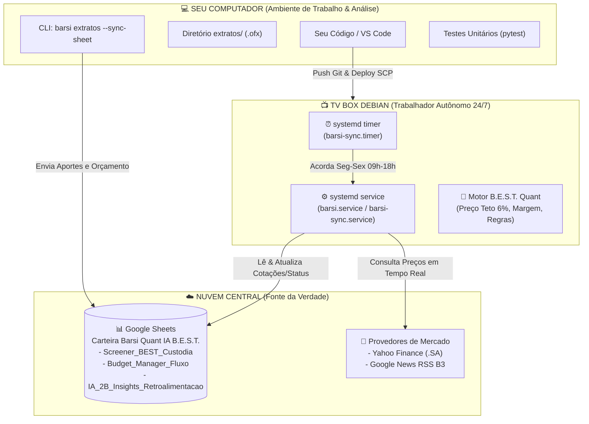

# 🧭 Arquitetura & Guia Operacional — Barsi Quant IA

Este documento explica de forma clara, didática e transparente o funcionamento do ecossistema **Barsi Quant IA**, o papel de cada dispositivo (seu PC vs. sua TV Box), como os dados fluem e como operar o sistema.

---

## 1. Visão Geral da Arquitetura: PC vs. TV Box



---

## 2. O que realmente faz a TV Box e o que faz o seu PC?

| Dispositivo | Função Principal | Quando Precisa Estar Ligado? | Consumo de Energia / RAM |
| :--- | :--- | :--- | :--- |
| **💻 Seu PC** | Desenvolvimento, programação, testes, adição de novos arquivos de extrato bancário (`extratos/*.ofx`) e controle manual. | Apenas quando você estiver trabalhando ou usando o computador. | Variável (computador comum). |
| **📺 TV Box** | **Operador Autônomo Barsi:** Acorda pontualmente de hora em hora (09h às 18h, Seg a Sex), consulta as cotações da B3 na internet, calcula o Preço Teto Barsi e atualiza o Google Sheets. | **Sempre ligada na tomada (24/7)**, conectada ao Wi-Fi. | **Gasta ~3 Watts** (menos que uma lâmpada LED). Usa ~110 MB de RAM apenas nos 12s em que roda e depois desliga! |

### O que acontece quando seu PC estiver desligado?
**Absolutamente nada é interrompido!**  
A TV Box é 100% autônoma e independente do seu PC. Ela fala diretamente com a internet (Yahoo Finance) e com a nuvem do Google (Google Sheets).  
Mesmo que você viaje ou seu computador fique desligado por dias, a TV Box continuará atualizando sua planilha de hora em hora durante todo o horário do pregão da B3. Você pode abrir o Google Sheets pelo seu celular a qualquer momento e ver as cotações e recomendações atualizadas.

---

## 3. A TV Box fica sempre rodando na memória?

**Não!** E isso é um dos maiores trunfos da arquitetura que implementamos:
* Se deixássemos um processo Python rodando sem parar (em loop infinito com `while True`), ele ficaria consumindo memória RAM e retendo conexões 24 horas por dia.
* Em vez disso, configuramos um **Systemd Timer nativo do Linux**:
  1. A TV Box fica em repouso com **0% de uso de CPU** pelo agente.
  2. Quando dá o minuto 00 da hora (ex: 10:00:00), o Linux dispara o `barsi-sync.service`.
  3. O Python acorda, processa os 10 ativos em **~12 segundos** (consumindo apenas ~110 MB de RAM temporária).
  4. Grava os dados no Google Sheets e o processo **se encerra automaticamente**.
  5. Toda a memória RAM é imediatamente devolvida ao sistema operacional.

---

## 4. Como a TV Box executa Ollama / IA local?

> ⚠️ **Fato de Engenharia:** A TV Box **NÃO executa Ollama localmente**, e isso foi uma decisão deliberada de arquitetura.

* **O Hardware:** A TV Box (chip S905W) possui apenas **874 MB de memória RAM total**.
* **O Requisito do Ollama + Gemma-2-2B:** Um modelo de linguagem de 2 bilhões de parâmetros (como Gemma 2B) exige no mínimo **2,5 GB a 3 GB de RAM** apenas para carregar os pesos na memória.
* Se tentássemos rodar o Ollama na TV Box, o Linux entraria em travamento imediato por falta de memória (OOM Panic).
* **A Solução:** Criamos o padrão **Hexagonal / Strategy**. O sistema usa o **`RuleEngineAdapter`** (um motor quantitativo puro das regras de Luiz Barsi). Ele calcula Preço Teto ($Preço = DPA / 0,06$), Margem de Segurança e gera os insights sem precisar de nenhuma GPU ou modelo pesado.
* Se no futuro você quiser usar IA generativa avançada (como Gemma ou GPT), a TV Box pode ser configurada para chamar uma API externa (ou chamar o Ollama rodando no seu PC apenas quando o PC estiver ligado).

---

## 5. Qual a diferença entre `__main__.py` e `http.py`?

* **`src/barsi/__main__.py` (Interface de Linha de Comando - CLI):**  
  É o ponto de entrada para execução manual no terminal. Permite rodar comandos diretos:
  - `python -m barsi run`: Roda uma sincronização pontual da carteira.
  - `python -m barsi extratos`: Lê e concilia todos os extratos bancários da pasta `extratos/`.
  - `python -m barsi extratos --sync-sheet`: Envia os números conciliados para o Google Sheets.

* **`src/barsi/api/http.py` (API Web FastAPI):**  
  É um servidor HTTP que disponibiliza rotas como:
  - `GET /health`: Informa o status da TV Box, memória RAM livre e última execução.
  - `POST /run`: Permite disparar uma sincronização via requisição web (webhook).  
  *Nota: Na TV Box, como usamos o timer do systemd para rodar em lote, o servidor HTTP é opcional e não precisa ficar ligado consumindo porta/RAM.*

---

## 6. Comandos Úteis na TV Box (via SSH)

Conecte na TV Box pelo terminal do seu PC:
```bash
ssh cleiton@192.168.100.72
# senha: compstream
```

### Comandos do Serviço:
```bash
# Ver o agendamento do timer (quando será a próxima execução)
systemctl list-timers barsi-sync.timer

# Disparar uma sincronização imediata manualmente
sudo systemctl start barsi.service
# (ou sudo systemctl start barsi-sync.service)

# Ver os logs da última execução em tempo real
journalctl -u barsi-sync.service -n 30 --no-pager
```

---

## 7. Conciliação de Extratos Bancários (OFX)

O módulo `ofx_service.py` agora analisa com precisão cirúrgica de centavos:
1. **Entradas:** Salário recebido via TED/Pix e Proventos/Dividendos creditados pela B3.
2. **Estornos & Cancelamentos (Regra do MXRF11):**  
   Se uma ordem de compra for debitada e depois cancelada/estornada (gerando um crédito no extrato), o sistema **anula o crédito contra o débito**, garantindo que apenas o valor efetivo seja contabilizado.
3. **Saídas Fixas:** Fatura de cartão Nubank, tributos (DAS Simples, Sefaz/Licenciamento), cooperativa (Ailos) e moradia/família.
4. **Reserva / Colchão:** Aplicações no RDB/Caixinha Turbo.
5. **Aportes Barsi:** Separação automática entre ações B.E.S.T. e fundos imobiliários.

Para rodar a conciliação no PC a qualquer momento:
```bash
python -m barsi extratos
```
E para enviar os dados para a aba `Budget_Manager_Fluxo`:
```bash
python -m barsi extratos --sync-sheet
```
