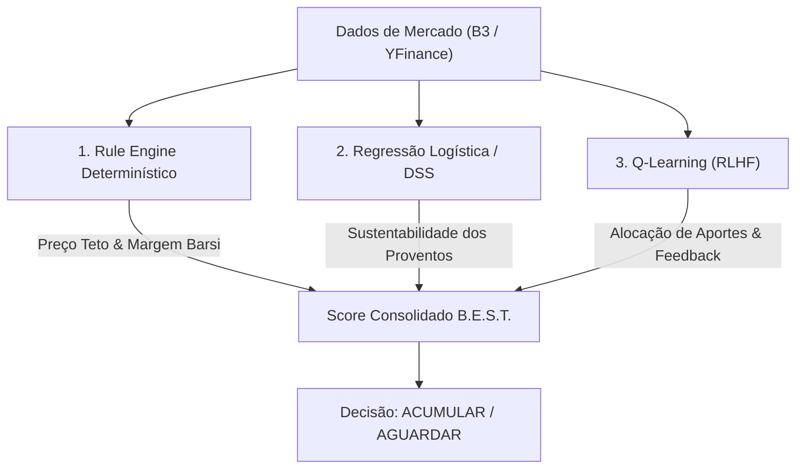

# 🏦 Sistema Previdenciário Barsi Quant IA — Agente Resiliente

Sistema de investimento previdenciário e geração de renda passiva baseado no **Método Barsi (Setores B.E.S.T.)**, construído sob **Arquitetura Hexagonal (Ports & Adapters)** com **persistência canônica em SQLite (Path B)**, interface web interativa completa (**Web Suite 2.0**) e otimizado para execução autônoma em hardware **Edge / SBC (TV Box Amlogic S905W · ARM64)** integrado a **Cloudflare Tunnel/Workers**.

---

## 🏛️ Diretrizes Arquiteturais Centrais (Path B)

1. **Fonte Canônica da Verdade (SQLite)**: O banco de dados local `barsi.db` (ou `memory/barsi_memory.db`) via `BudgetRepository` é a **única fonte primária da verdade**. Todas as leituras e edições de carteira, transações OFX, categorias e usuários operam diretamente no SQLite com latência ultrabaixa e zero dependência de APIs externas de planilhas em runtime.
2. **Exportação Sob Demanda (Unidirecional)**:
   - **Google Sheets**: Sincronização disparada manualmente via interface web (`/api/export/sheets`) ou CLI (`python -m barsi export-sheets`).
   - **Excel (.xlsx)**: Exportação gerada dinamicamente sob demanda para download (`/api/export/xlsx` ou `python -m barsi export-xlsx`), garantindo arquivos limpos sem manter planilhas obsoletas no disco.
3. **Isolamento e Segurança**:
   - Autenticação e RBAC (Controle de Acesso Baseado em Perfis: `admin`, `investidor`, `leitor`).
   - Criptografia de senhas com PBKDF2 e tokens de sessão JWT assinados.
   - 100% dos testes rodam sobre bancos temporários (`tmp_path`) sem tocar na base de produção.

---

## 🖥️ Web Suite 2.0 — Recursos do Painel Web

A aplicação conta com uma interface moderna em HTML5 + CSS responsivo + Vanilla JS (sem overhead de frameworks pesados de frontend):

- 💼 **Carteira Inteligente (`/carteira`)**: Tabela inline-editable com cotas atuais, aportes sugeridos, preço atual em tempo real, Preço Teto Barsi, margem de segurança e status de convicção.
- 📈 **Analytics & Benchmarks (`/analytics`)**:
  - Gráfico dinâmico de evolução patrimonial com base em snapshots reais.
  - Benchmarks comparativos em tempo real: **Carteira vs IBOVESPA (`^BVSP`) vs CDI Acumulado 12M (via API oficial do Banco Central do Brasil - BCB)** com fallback offline resiliente.
  - Histórico mensal de dividendos e distribuição setorial (Bancos, Energia, Saneamento, Telecomunicações, Seguros e FIIs).
- 💡 **Central de Insights & RLHF (`/insights`)**: Recomendações determinísticas de aporte com motor quantitativo e feedback do investidor (*Concordo / Discordo*) sincronizado em lote.
- 📑 **Conciliação Orçamentária OFX (`/extratos`)**: Upload e leitura de extratos bancários OFX, deduplicação idempotente por `fitid`/hash, visualização de receitas/despesas e gerenciador de palavras-chave para autoclassificação.
- 🎯 **Simulador de Aportes (`/aportes`)**: Distribuição interativa de aportes mensais via slider com respeito estrito à margem de segurança e priorização de yield.
- 👥 **Gestão de Usuários e RBAC (`/admin/users`)**: Criação, troca de perfil e exclusão de contas com isolamento de privilégios.
- 💾 **Backup do SQLite (`/api/backup/download`)**: Download seguro e direto do banco de dados completo (exclusivo para perfil `admin`).
- 📸 **Snapshots Diários Automáticos (`/api/snapshot/today`)**: Executados automaticamente a cada término de `/api/run`, com proteção preventiva contra sobrescrita por carteiras vazias.

---

## 🏗️ Arquitetura Hexagonal & Diagrama de Componentes

```text
               +-------------------------------------------------------------+
               |                    Nuvem / Interfaces                      |
               |                                                             |
               |  [Cloudflare Tunnel]    [Web Suite 2.0]     [Telegram / WPP] |
               +-------+---------------------+---------------------+---------+
                       |                     |                     |
                       v                     v                     v
+----------------------+---------------------+---------------------+----------------------+
| ADAPTERS (INBOUND)   |                     |                     |                      |
|                      |  FastAPI Router     |  RBAC Middleware    |  CLI Typer           |
|                      |  /carteira /run ... |  (Session Tokens)   |  (barsi CLI)         |
+----------------------+---------------------+---------------------+----------------------+
| PORTS                |                     |                     |                      |
|                      |  HTTP Controller    |  HistoryPort        |  SheetsPort (Export) |
+----------------------+---------------------+---------------------+----------------------+
|                                                                                         |
| DOMÍNIO PURO & REGRAS B.E.S.T. (Sem I/O, 100% Testável)                                 |
|                                                                                         |
|       * Preço Teto Barsi: Teto = DivProj / 0.06                                         |
|       * Margem de Segurança: ((Teto - Preço) / Preço) * 100                             |
|       * Status Barsi: ACUMULAR (Margem >= 0) / AGUARDAR (Margem < 0)                    |
|       * Engine Determinístico de Regras & Quant AI (Score B.E.S.T.)                     |
|                                                                                         |
+----------------------+---------------------+---------------------+----------------------+
| PORTS                |                     |                     |                      |
|                      |  MarketDataPort     |  NewsPort           |  NotificationPort    |
+----------------------+---------------------+---------------------+----------------------+
| ADAPTERS (OUTBOUND)  |                     |                     |                      |
|  [CachedMarket]      |  [GoogleNewsRSS]    |  [Telegram / WPP]   |  [BudgetRepository]  |
|   ├── YFinance       |   └── XML Parser    |   └── CallMeBot     |   └── SQLite Canonical
|   └── Brapi (token)  |                     |                     |                      |
+----------------------+---------------------+---------------------+----------------------+
                       |                     |                     |
                       v                     v                     v
               +-------------------------------------------------------------+
               |                  Hardware Alvo (TV Box)                     |
               |   Amlogic S905W (ARM64) · RAM < 250MB RSS · Sem GPU          |
               +-------------------------------------------------------------+
```

---

## 🤖 Ecossistema de Subagentes Antigravity

Conforme documentado no arquivo [`AGENTS.md`](../AGENTS.md), o sistema conta com subagentes especializados:

1. `barsi-quant-analyst`:
   - Análise quantitativa, validação de Preço Teto, Margem de Segurança e sustentabilidade de dividendos.
   - Filtros de setores perenes B.E.S.T. e governança dos modelos em `barsi.domain.rules` e `barsi.domain.quant_ai`.
2. `barsi-budget-conciliator`:
   - Processamento idempotente de extratos OFX, categorização orçamentária via palavras-chave e cálculo da capacidade de aporte mensal via `BudgetProjectionService`.

---

## 🛠️ Comandos da CLI (`barsi`)

O sistema conta com interface de linha de comando completa:

```bash
# Executar ciclo quantitativo diário de análise e cotações
python -m barsi run

# Sincronizar código, banco SQLite e reiniciar serviço na TV Box
python -m barsi sync-tvbox

# Exportar dados canônicos do SQLite sob demanda para Google Sheets
python -m barsi export-sheets

# Exportar carteira sob demanda para planilha Excel (.xlsx)
python -m barsi export-xlsx

# Conciliar arquivos OFX da pasta extratos/
python -m barsi parse-ofx

# Gerenciar usuários e acessos
python -m barsi user-add admin_user senha123 --role admin
python -m barsi user-list
python -m barsi user-del antigo_user
```

---

## 🔒 Dados Sensíveis e Proteção Contra Vazamento (Zero PII)

Este projeto processa extratos financeiros e credenciais de infraestrutura. Diretrizes obrigatórias:

### ✅ O que PODE ser commitado
- Código-fonte (`.py`, `.html`, `.js`, `.sh`, `.css`)
- Documentação técnica e arquitetural
- Templates de ambiente (`.env.example`, `pyproject.toml`)
- Testes com mocks e dados sintéticos

### ❌ O que NUNCA deve ser commitado
- `.env` e chaves de API reais
- `credentials.json` (Google Cloud Service Account)
- Extratos bancários reais (`extratos/*.ofx`)
- Banco de dados de produção (`barsi.db`, `memory/*.db`)
- Planilhas `.xlsx` com dados patrimoniais reais
- Nomes de titulares de contas bancárias ou IPs internos privados

---

## 🧪 Testes Automatizados & Qualidade de Código

A suíte de testes utiliza `pytest` com asserções estritas, isolamento via `tmp_path`, mocks para chamadas de rede e validação de cobertura:

```bash
# Executar suíte completa de testes com gate de cobertura mínimo de 40%
pytest tests/ -v --cov=barsi --cov-fail-under=40
```

- **Total de Testes**: 91 testes automatizados (100% passando).
- **Cobertura de Código**: > 61% (superando o gate do CI).
- **Isolamento**: Testes de endpoints, repositórios e serviços rodam de forma independente e determinística.

---

## 🚀 Sincronização e Deploy na TV Box (ARM64)

Para atualizar o servidor em execução na TV Box doméstica (`usuario@barsi-tvbox` ou IP da rede):

```bash
python -m barsi sync-tvbox
```

O comando realiza automaticamente:
1. Sincronização dos extratos bancários `.ofx`;
2. Atualização dos códigos-fonte e templates HTML;
3. Sincronização do banco SQLite `barsi_memory.db`;
4. Reinicialização limpa do serviço `barsi-api.service` via SSH.

---

## 🎯 Machine Learning & Arquitetura Quant

### 🔍 A Realidade dos Dados em Finanças Barsi
Diferente de modelos de visão computacional ou processamento de linguagem natural que operam sobre milhões de parâmetros desestruturados, a carteira Barsi Quant IA lida com **dados tabulares estruturados (8 a 16 métricas numéricas por ativo)** sobre um universo restrito de **15 a 100 ativos B.E.S.T.**:

| Dimensão | Realidade da Aplicação | Abordagem Quant Adotada |
| :--- | :--- | :--- |
| **Tipo de Dado** | Tabular numérico (Payout, DY, Dívida/EBITDA, ROE, Margem) | Features normalizadas e lineares |
| **Tamanho da Amostra** | 15 ativos em carteira, screening de até 100 ações | **Evitar overfit**: modelos rasos e lineares |
| **Hardware Alvo** | Edge ARM64 (TV Box), 1.2GHz, < 250MB RAM livre | RAM < 1MB, zero GPU, treino em < 1s |
| **Latência de Inferência** | Sub-milissegundo (< 1ms) para UI interativa | Forward pass puro sem overhead de runtime pesado |
| **Interpretabilidade** | 100% mandatória (saber por que o ativo foi recomendado) | Pesos explícitos e auditáveis |

### 🏆 Arquitetura de Ensemble Quantitativo
O sistema utiliza um ensemble de três motores especializados:



1. **Rule Engine Determinístico Barsi**: Aplica as fórmulas canônicas de Luiz Barsi Filho:
   $$\text{Preço Teto} = \frac{\text{Proventos Projetados}}{0{,}06}$$
   $$\text{Margem de Segurança} = \frac{\text{Preço Teto} - \text{Cotação}}{\text{Cotação}} \times 100$$
2. **Dividend Sustainability Scorer (DSS) — Regressão Logística / TinyMLP**:
   - Classificação probabilística da sustentabilidade dos dividendos futuros.
   - Pesos lineares balanceados: penaliza alto payout (>90%) associado a alavancagem elevada ($\text{Dívida Líquida}/\text{EBITDA} > 2.5$), e bonifica ROE consistente (>15%) e geração de caixa.
   - Treinamento instantâneo via Maximum Likelihood Estimation (MLE) com proteção matemática contra overfitting.
3. **Q-Learning de Alocação de Aportes com RLHF**:
   - Ajusta a distribuição de capital entre os ativos com maior margem de segurança.
   - Refinado continuamente através dos botões de feedback do investidor (*Concordo / Discordo*) na interface web.

---

## 🔮 Roadmap Estratégico de Valor Real

O desenvolvimento do Barsi Quant IA é norteado por entregas de valor tangível à acumulação de patrimônio e independência financeira, dividido em prioridades claras:

### 🥇 P0 — Fundamentos & Rastreamento Real (Implementado)
- [x] **Rastreamento de Dividendos Reais Recebidos (`dividends_received`)**:
  - Registro de proventos creditados na conta da corretora (Dividendo, JCP, Rendimento FII) com data, ticker e valor líquido.
  - Agrupamento histórico por mês e cálculo automático da capacidade de reinvestimento da bola de neve.
- [x] **Custo Médio e Yield on Cost (YoC)**:
  - Cálculo contínuo de $\text{Yield on Cost} = \frac{\text{DPA Projetado}}{\text{Custo Médio}} \times 100$.
  - Exibição inline na tabela da carteira (`/carteira`) para mensurar a rentabilidade sobre o capital efetivamente investido.
- [x] **2FA TOTP (RFC 6238) para Acesso Administrativo**:
  - Autenticação em duas etapas nativa em Python (sem dependências externas) compatível com Google Authenticator, Authy e 1Password.
  - Setup via QR Code no painel de configurações e verificação com tolerância temporal de 30 segundos.
- [x] **Deduplicação de Alertas Telegram**: Trava diária no SQLite (`notification_log`) limitando notificações a no máximo 1 alerta por ticker/dia.

### 🥈 P1 — Inteligência Preventiva & Automação Mensal
- [ ] **Alertas Preventivos de Mudança de Tese**: Monitoramento autônomo de fatos relevantes e notícias para detectar cortes abruptos de dividendos, aumento abusivo de alavancagem ou perda de concessões nos setores B.E.S.T.
- [ ] **Relatório Mensal Automatizado em PDF**: Fechamento automático de mês gerando documento PDF consolidado com patrimônio, proventos recebidos, economia no orçamento e plano de aportes do mês seguinte.
- [ ] **Simulador de Bola de Neve (Snowball Backtesting)**: Projeção de longo prazo com base no histórico real de cotações (`price_history`), reinvestimento dos proventos e taxa de crescimento dos dividendos.

### 🥉 P2 — Experiência do Investidor & Expansão
- [ ] **Barsi Wrapped Anual**: Retrospectiva visual do ano com total de proventos recebidos, novo custo médio alcançado e ativos mais rentáveis.
- [ ] **PWA Instalável (Progressive Web App)**: Atalho de aplicativo no celular para consulta ultrarrápida com funcionamento offline.
- [ ] **Screening Ampliado B3**: Monitoramento automático de todas as ações elegíveis aos setores B.E.S.T. na bolsa de valores.

### ⛔ Filtro Negativo — O que NÃO Faremos
Para garantir foco, performance e confiabilidade, o projeto adota decisões conscientes de engenharia:
- ❌ **Não usaremos Deep Learning profundo para seleção de ações**: Incompatível com o tamanho da amostra (15-100 ativos) e desprovido de explicabilidade matemática.
- ❌ **Não migraremos o SQLite para PostgreSQL**: O SQLite local em modo WAL fornece transações em < 5ms, consumo de memória insignificante e elimina completamente o overhead de servidores de banco.
- ❌ **Não implementaremos Trading Automatizado ou Day-Trade**: A filosofia de Luiz Barsi Filho baseia-se em compra e custódia previdenciária de longo prazo (*Buy and Hold*).
- ❌ **Não utilizaremos Kubernetes ou Microserviços**: Arquitetura modular monolítica otimizada para o processador ARM64 da TV Box doméstica.

---

## 🚀 CI/CD & Deploy Contínuo via Tailscale SSH

O pipeline de deploy é totalmente automatizado via GitHub Actions e conectado de forma segura à TV Box ARM64:

```mermaid
sequenceDiagram
    participant Dev as Desenvolvedor
    participant Git as GitHub (dev / tags)
    participant CI as GitHub Actions (Ubuntu)
    participant TS as Tailscale VPN (WireGuard)
    participant Box as TV Box (Debian ARM64)

    Dev->>Git: git push tag v*.*.*
    Git->>CI: Dispara deploy.yml
    CI->>TS: Conecta ao Tailnet (OAuth Client ephemeral)
    CI->>Box: Detecta WorkingDirectory via systemd
    CI->>Box: Backup prévio (SQLite + código em memory/barsi_code_prev)
    CI->>Box: Sincronização diferencial de arquivos via rsync
    CI->>Box: sudo systemctl restart barsi-api.service
    CI->>Box: Health check com janela de warm-up (10s + 15 tentativas)
    CI-->>Dev: Notificação de sucesso / Rollback automático em falha
```

### 🔒 Segurança Operacional do Pipeline
1. **Rede Tailscale Privada**: Acesso SSH encapsulado diretamente pela rede WireGuard criptografada da Tailnet (`barsi-tvbox`), sem portas abertas no roteador doméstico.
2. **Rollback Automático**: Caso a API não responda no health check em até 40s após o restart, o código anterior preservado em `memory/barsi_code_prev` é automaticamente restaurado.
3. **Sudoers NOPASSWD Restrito**: Permissão concedida exclusivamente para os binários `/bin/systemctl` e `/bin/journalctl`.

---

## 🧪 Testes Automatizados & Qualidade de Código

A suíte de testes utiliza `pytest` com asserções estritas, isolamento via `tmp_path`, mocks para chamadas de rede e validação de cobertura:

```bash
# Executar suíte completa de testes com gate de cobertura mínimo de 40%
pytest barsi_quant_ia/tests/ -v --cov=barsi --cov-fail-under=40
```

- **Total de Testes**: 108 testes automatizados (100% passando).
- **Cobertura de Código**: > 62% (superando amplamente o gate do CI).
- **Isolamento**: Testes de endpoints, repositórios e serviços rodam de forma independente e determinística.
